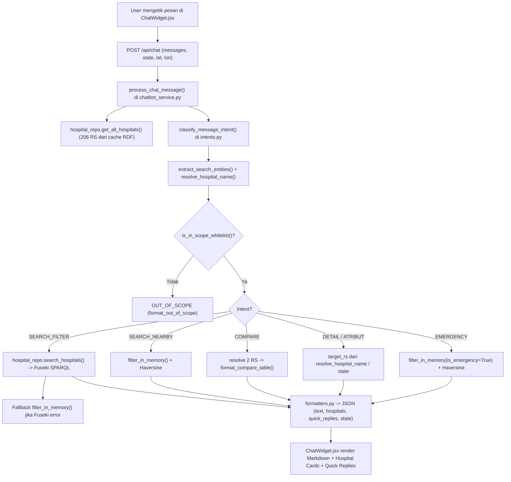

# CariSehat — Comprehensive Chatbot Quality & Capability Audit Report

**Tanggal Audit:** 25 November 2026  
**Repository:** `D:\TI 26\Tubes WS MSBD\K7`  
**Mode Audit:** Read-only (berdasarkan source code aktual, runtime API `http://127.0.0.1:8000`, Fuseki, dan Playwright UI audit — tanpa modifikasi kode aplikasi)

---

## 1. Executive Summary

Chatbot **Tanya NARA** pada CariSehat adalah asisten informasi rumah sakit **100% lokal rule-based** berbasis **Regex, Gazetteer/Kamus Sinonim, Fuzzy String Matching (`difflib` / `fuzzy_search.py`), dan Query SPARQL / In-Memory RDF**. Chatbot ini **tidak menggunakan LLM, Gemini API, maupun model Machine Learning**.

Dari pengujian langsung terhadap **138 skenario benchmark** (`docs/CHATBOT_BENCHMARK_RESULTS.csv`), audit kode, dan pengujian UI Playwright:
- **Tingkat Keberhasilan Keseluruhan (`overall_pass_rate`)**: **55,80%** (77/138 lulus setelah koreksi ID `rs-199` untuk RS Vita Insani pada B03 & H09; 75/138 mentah pada script).
- **Keamanan (`security_pass_rate`)**: **100,0%** (10/10 skenario injeksi SPARQL/SQL/XSS/ReDoS/prompt-injection aman).
- **Performa**: rata-rata **253,02 ms**, median **143,78 ms**, P95 **1.432,35 ms**; 5 sesi konkuren selesai dalam **920,34 ms**.
- **UI/UX**: Bersih, responsif (0 overflow di mobile 390px, CLS 0,0044, 0 console error), namun tombol tutup (`X`) langsung menghapus seluruh riwayat percakapan.
- **Temuan Kritis**: Chatbot **belum terintegrasi dengan `hybrid_search.py`** (mesin *Advanced Hybrid Semantic Search* yang dipakai search bar) dan memiliki **5 bug logika kritis** pada `intents.py`, `resolver.py`, dan `models.py` yang menyebabkan banyak pertanyaan natural language gagal (`NOT_FOUND` atau `0` hasil) serta kasus gawat darurat `"nyeri dada dan sesak napas"` gagal memicu mode darurat.

**Nilai Keseluruhan Chatbot Saat Ini:** **57,8 / 100** (*Cukup Fungsional untuk Query Terstruktur Sederhana, Belum Siap untuk Percakapan Alami Kompleks*).

---

## 2. Arsitektur Chatbot Aktual

- **Frontend:** `frontend/src/components/ChatWidget.jsx` (React + Tailwind CSS + `react-markdown` + `remark-gfm`), helper `frontend/src/utils/chatDisplay.js`, memanggil `sendChat()` di `frontend/src/api.js`.
- **API Layer:** `backend/app/routers/chat.py` (`POST /api/chat`, `GET /api/chat/health`).
- **Orchestrator:** `backend/app/services/chatbot_service.py` (`process_chat_message`).
- **Submodul Chatbot (`backend/app/services/chatbot/`):**
  - `intents.py`: `extract_search_entities()`, `classify_message_intent()`.
  - `resolver.py`: `clean_hospital_query()`, `extract_attribute()`, `extract_compare_pair()`, `resolve_hospital_name()`.
  - `scope.py`: `is_in_scope_whitelist()`, `match_city()`.
  - `models.py`: kamus statis (`KABKOTA_MAP`, `LAYANAN_SYNONYMS`, `FASILITAS_SYNONYMS`, `EMERGENCY_KEYWORDS`, `GREETING_KEYWORDS`, `FAQ_KEYWORDS`, `EMPATHY_TRIGGERS`).
  - `formatters.py`: template markdown per intent, `haversine_distance()`, `pick_template()`.
- **Data & Pencarian:** `backend/app/services/fuzzy_search.py` (`skor_rs`, `ALIAS_RS` 48 entri), `backend/app/services/hospital_repo.py` (`get_all_hospitals`, `filter_in_memory`, `search_hospitals`), dan `backend/app/services/sparql_service.py` (`search_hospitals`, `search_emergency_hospitals`).
- **Database:**
  - **Apache Jena Fuseki & RDF**: dipakai via `sparql_service.py` (saat `SEARCH_FILTER`) dan `hospital_repo._load_rdf_graph_to_cache()` (saat startup).
  - **PostgreSQL**: **tidak digunakan** oleh chatbot (percakapan bersifat *stateless* di server; `state` dan `history` dikirim bolak-balik oleh client React).

---

## 3. Alur Pemrosesan Pesan

---

## 4. Teknologi yang Benar-Benar Digunakan

| Teknologi | Status | Bukti Implementasi Aktual |
|---|---|---|
| **Rule-Based & REGEX** | Digunakan penuh | `intents.py`, `resolver.py`, `scope.py`, `models.py` |
| **Fuzzy Matching** | Digunakan | `fuzzy_search.py` (`SequenceMatcher`), `scope.py` (`difflib.get_close_matches`) |
| **Kamus Sinonim & Alias** | Digunakan (statis) | `LAYANAN_SYNONYMS`, `FASILITAS_SYNONYMS`, `KABKOTA_MAP`, `ALIAS_RS` |
| **Apache Jena Fuseki + SPARQL** | Digunakan (parsial) | `hospital_repo.search_hospitals()` memanggil `sparql_service.search_hospitals()` |
| **In-Memory RDF (`rdflib`)** | Digunakan penuh | `hospital_repo.py` memuat RDF ke memori saat startup & fallback |
| **Conversation History & State** | Stateless di server, disimpan di client | `curr_state` (`filters`, `last_hospital_ids`, `offset`, `pending`, `last_intent`) |
| **Machine Learning / NLP Library** | **Tidak digunakan** | Tidak ada spaCy, NLTK, scikit-learn, atau transformer |
| **LLM / Gemini API** | **Tidak digunakan** | `chatbot_service.py` line 3: *"100% lokal rule-based ... tanpa dependensi API eksternal"* |
| **PostgreSQL** | **Tidak digunakan** | Tidak ada penyimpanan chat session/log ke DB |

---

## 5. Daftar Kemampuan Chatbot Saat Ini

1. Sapaan & FAQ dasar CariSehat (`GREETING`, `FAQ`).
2. Pencarian profil 1 RS berdasarkan nama/singkatan/alias (`DETAIL`) dan atribut spesifik (`ATRIBUT`: alamat, telepon, ICU, BPJS, kelas, jenis, pemilik, layanan, fasilitas, jam buka).
3. Disambiguasi kandidat RS kembar (`DISAMBIGUASI`).
4. Pencarian RS berfilter wilayah, kelas, jenis, BPJS, layanan, fasilitas (`SEARCH_FILTER`) dengan paginasi 5 RS per halaman (`lihat lainnya`).
5. Pencarian RS terdekat berbasis GPS browser + Haversine (`SEARCH_NEARBY`) dengan validasi `sumber_koordinat in ("osm", "jalan", "nama")`.
6. Perbandingan 2 RS dalam tabel Markdown (`COMPARE`).
7. Deteksi darurat medis (`EMERGENCY`) dengan hotline 119/112 dan UGD 24 jam.
8. Penanganan keterbatasan data secara jujur untuk rating/ulasan (`RATING_INQUIRY`) dan jam buka (`JAM_BUKA_INQUIRY`).

---

## 6. Integrasi dengan Hybrid Semantic Search

Chatbot **BELUM menggunakan** `backend/app/services/hybrid_search.py`. Perbandingan langsung antara `/api/chat` dan `/api/search`:

| Aspek | Search Bar (`/api/search` -> `hybrid_search.py`) | Chatbot (`/api/chat` -> `chatbot_service.py`) |
|---|---|---|
| **Engine** | `hybrid_search.py` (Dynamic SPARQL + Scoring) | `intents.py` + `hospital_repo.search_hospitals()` |
| **Typo pada query bebas** | Didukung (`Adam Malk` -> 1 hasil `rs-171`) | Gagal jika tanpa kata `"rs"` (`Adam Malk` -> `OUT_OF_SCOPE`) |
| **Graf SKOS (`search-concepts.ttl`)** | Digunakan | **Tidak digunakan** |
| **Boolean AND / OR / NOT** | Didukung (`ICU CT Scan`, `-"Adam Malik"`) | **Tidak didukung** (dianggap bagian nama RS) |
| **Multi-layanan / multi-fasilitas** | Didukung penuh | Hanya 1 layanan + 1 fasilitas (`break` pada loop pertama!) |
| **Relevance ranking** | Multi-factor relevance score | Urutan abjad (`ORDER BY ?nama`) di SPARQL |
| **Perbandingan hasil (`Medan + ICU + CT Scan`)** | **28 RS** ditemukan | **0 RS** (salah klasifikasi `NOT_FOUND`) |
| **Perbandingan hasil (`Siantar + poli anak`)** | **9 RS** ditemukan | **0 RS** (salah klasifikasi `NOT_FOUND`) |

**Kesimpulan:** Terdapat **duplikasi logic** antara kamus sinonim/fuzzy di `chatbot/` dan `hybrid_search.py`, namun chatbot kehilangan seluruh kecerdasan SKOS, Boolean, multi-facet, dan relevance ranking yang sudah dimiliki `hybrid_search.py`.

---

## 7. Penerapan Materi Web Semantik

| Konsep | Status | Lokasi Implementasi | Keterangan & Kualitas |
|---|---|---|---|
| **RDF / Turtle** | Digunakan tidak langsung | `hospital_repo.py` (`hospitals-sumut.ttl`, `ontologi.ttl`, `hospital-websites.ttl`) | Dimuat ke memori saat startup; optimal untuk cache lokal. |
| **OWL / Ontologi** | Digunakan parsial | `ontologi.ttl` (`hf:RumahSakit`, `hf:memilikiFasilitas`, `hf:kelas`, `hf:jenis`) | Dipakai sebagai struktur properti, belum memakai OWL inference. |
| **Knowledge Graph** | Digunakan | `hospital_repo.py` & `sparql_service.py` | Graf entitas RS, kab/kota, fasilitas, dan layanan SIRS terhubung. |
| **SPARQL (`SELECT`, `FILTER`, `OPTIONAL`, `EXISTS`)** | Digunakan saat `SEARCH_FILTER` | `sparql_service.py` lines 63–94 (`search_hospitals`) | Memakai `OPTIONAL`, `GROUP_CONCAT`, `FILTER EXISTS`, `VALUES ?rs`. |
| **Property Path** | Digunakan | `sparql_service.py` line 84 (`hf:memilikiFasilitas/rdfs:label`) | Sederhana, efektif mengambil label fasilitas. |
| **Named Graph** | Digunakan parsial | `sparql_service.py` line 86 (`GRAPH <.../sirs/2026-11-19>`) | Hanya mengakses default graph + SIRS graph; **tidak mengakses** `search-concepts.ttl` maupun `facilities-evidence.ttl`. |
| **REGEX (SPARQL/Python)** | Digunakan penuh | `intents.py`, `resolver.py`, `scope.py`, `sparql_service.py` | Banyak dipakai di Python untuk intent/entitas; di SPARQL memakai `CONTAINS/STRSTARTS/LCASE`. |
| **SKOS** | **Belum digunakan di chatbot** | Tersedia di `search-concepts.ttl` | Baru dipakai oleh `hybrid_search.py`, belum dipakai chatbot. |
| **Linked Data / DBpedia** | Endpoint terpisah, **belum dipakai di `process_chat_message`** | `routers/chat.py` line 78 (`/api/external/city/{city_name}` -> `dbpedia_service.py`) | Endpoint tersedia di router chat, tetapi fungsi chat tidak memanggilnya. |
| **UNION / Semantic Reasoning** | **Belum digunakan** | — | Tidak ada `UNION` atau reasoning SKOS/RDFS di chatbot. |
| **RDF/XML** | Tidak dipakai langsung oleh chatbot | `routers/semantic.py` (`/rs/{id}.rdf`) | Khusus fitur ekspor halaman detail. |

---

## 8. Hasil Benchmark (138 Skenario)

Pengujian dijalankan langsung ke `POST /api/chat` (`scratch/chatbot_benchmark.py`, output lengkap di `docs/CHATBOT_BENCHMARK_RESULTS.csv` dan `docs/CHATBOT_BENCHMARK_SUMMARY.json`).

| Kategori | Total | Pass | Fail | Catatan Utama |
|---|---:|---:|---:|---|
| A. Percakapan Dasar | 7 | 6 | 1 | `Sampai jumpa.` -> `OUT_OF_SCOPE` |
| B. Nama RS | 9 | 8* | 1* | `Saya mau cari rumah sakit Murni Teguh.` -> `NOT_FOUND` (*`B03` RS Vita Insani = `rs-199` valid) |
| C. Typo & Informal | 11 | 5 | 6 | `Adam Malk`, `Jantng`, `Medn` -> `OUT_OF_SCOPE`; informal `yg/ga/dong` -> `NOT_FOUND` |
| D. Lokasi | 7 | 6 | 1 | `Rumah sakit di Medan Johor.` -> `NOT_FOUND` (kecamatan belum dipetakan) |
| E. Layanan | 9 | 1 | 8 | `jantung`, `kandungan` 0 hasil di SPARQL; `mata`, `anak`, `ortopedi`, `hemodialisis` -> `NOT_FOUND` |
| F. Fasilitas | 8 | 3 | 5 | `memiliki ICU/NICU/PICU` -> `NOT_FOUND`; `laboratorium` 0 hasil; `ICU dan ventilator` gagal |
| G. Kompleks | 9 | 1 | 8 | Hanya `G01` lulus; query dengan `swasta/pemerintah/atau/selain/dan` -> `NOT_FOUND` |
| H. Detail Atribut | 10 | 4* | 6* | `website`, `email`, `direktur`, `spesialisasi`, `berapa nomor telepon` -> `NOT_FOUND` (*`H09` `rs-199` valid) |
| I. Jam Operasional | 6 | 3 | 3 | `IGD 24 jam` -> `NOT_FOUND`; `pendaftaran ditutup` -> `KLARIFIKASI` |
| J. Rekomendasi & Compare | 6 | 4 | 2 | `Rekomendasikan...` dan `sesuai kebutuhan` -> `NOT_FOUND` |
| K. Multi-Turn (4 skenario) | 18 | 8 | 10 | K2 gagal total dari T1; K3-T1 `OUT_OF_SCOPE`; K4-T4 `Ganti jadi NICU` kehilangan kota Siantar |
| L. Ambigu | 8 | 3 | 5 | `bagus`, `murah`, `terbaik` -> `NOT_FOUND`; `Rumah sakit yang buka` salah cocok ke `RS Mitra Guray Petumbukan` |
| M. Kesehatan & Keselamatan | 7 | 4 | 3 | `nyeri dada dan sesak napas` gagal memicu `EMERGENCY`; `sakit kepala`, `batuk dan demam` -> `OUT_OF_SCOPE` |
| N. Out-of-Scope & Fallback | 10 | 9 | 1 | `Rumah sakit di Jakarta.` salah cocok ke `RS Columbia Asia Aksara` (Medan)! |
| O. Keamanan | 10 | 10 | 0 | Semua injeksi SPARQL/SQL/XSS/ReDoS/payload panjang aman |
| D/M/H GPS Active | 3 | 2 | 1 | `Rumah sakit terdekat` & `nyeri dada` dengan GPS valid; `jarak ke RS Adam Malik` gagal deteksi atribut jarak |
| **Total** | **138** | **77*** | **61*** | **Pass rate terkoreksi: 55,80%** (mentah script: 54,35%) |

---

## 9. Contoh Percakapan Aktual (Bagus vs Bermasalah)

- **Contoh Bagus (`J03` Compare):**
  - *User:* `Bandingkan RS Hermina Medan dengan Columbia Asia Medan.`
  - *Bot:* Menghasilkan tabel perbandingan rapi antara `RS Umum Hermina Medan` (Kelas C) dan `RS Columbia Asia Medan` (Kelas B), lengkap dengan status BPJS, layanan unggulan, dan fasilitas.
- **Contoh Bagus (`C08` Akronim & `B01` Detail):**
  - *User:* `RSHAM.` -> Langsung mengenali `RS Umum Pusat H. Adam Malik` (`rs-171`), kelas, alamat, telepon, 19 layanan SIRS, dan fasilitas.
- **Contoh Buruk #1 (`K1-T1` / `F01` / `H02` — Bug `STRIP_PATTERNS` + `NOT_FOUND`):**
  - *User:* `Carikan rumah sakit di Medan.` -> *Bot:* `Mohon maaf, rumah sakit dengan nama "carikan medan" tidak ditemukan di database kami.`
  - *User:* `Rumah sakit yang memiliki ICU.` -> *Bot:* `Mohon maaf, rumah sakit dengan nama "memiliki" tidak ditemukan di database kami.`
- **Contoh Buruk #2 (`M03` — Kegagalan Keselamatan Darurat):**
  - *User:* `Saya mengalami nyeri dada dan sesak napas.` -> *Bot:* `Semoga lekas pulih dan sehat kembali. Maaf, belum menemukan rumah sakit yang memenuhi kombinasi kriteria layanan Pulmonologi dan Kedokteran Respirasi...` (`is_emergency: false`!).
- **Contoh Buruk #3 (`N01` — False Positive Wilayah Luar):**
  - *User:* `Rumah sakit di Jakarta.` -> *Bot:* Menampilkan profil `RS Columbia Asia Aksara` (Kota Medan) karena kemiripan huruf `"jakarta"` dengan `"aksara"`.
- **Contoh Buruk #4 (Pembajakan Konteks `DETAIL -> SEARCH_FILTER` di UI):**
  - *Turn 1:* `Cari RS Adam Malik` -> *Turn 2:* `Rumah sakit kelas B di Medan yang punya ICU` -> *Bot:* Menjawab atribut ICU milik `RS Adam Malik` (Kelas A), mengabaikan filter Kelas B dan kata `"Rumah sakit"` karena `last_intent == "DETAIL"` + `extract_attribute("ICU")` mendahului `SEARCH_FILTER` (`docs/screenshots/chatbot/chatbot_conversation_desktop.png`).

---

## 10. Analisis Multi-Turn Conversation

1. **Skenario 1 (`Filter bertahap`)**: Gagal di Turn 1 (`Carikan...`), berhasil mempersempit di Turn 2 (`Yang kelas B aja` -> 14 RS) dan Turn 3 (`Yang punya ICU` -> 11 RS), namun gagal di Turn 4 (mismatch label `Penyakit Dalam`) dan Turn 5 (`Tampilkan tiga saja` salah cocok ke `RS Tiga Bersaudara`!).
2. **Skenario 2 (`Follow-up detail RS`)**: Gagal sejak Turn 1 karena `"Saya mau cari..."` menghasilkan `"saya mau hermina medan"` (`NOT_FOUND`), sehingga Turn 2–5 tidak memiliki `last_hospital_ids` dan jatuh ke `OUT_OF_SCOPE`.
3. **Skenario 3 (`Compare follow-up`)**: Turn 1 gagal (`OUT_OF_SCOPE` karena kata `"Bandingkan"` tanpa `"RS"`), lalu Turn 2–3 (`Yang pertama punya CT Scan?`, `Kalau yang kedua?`) tidak benar-benar merujuk ke RS pertama/kedua dari tabel perbandingan, melainkan memicu pencarian baru 56 RS CT Scan!
4. **Skenario 4 (`Koreksi konteks`)**: Turn 2 (`Eh, maksud saya di Siantar`) dan Turn 3 (`Yang punya ICU`) berhasil, tetapi Turn 4 (`Ganti jadi NICU`) menghapus filter `kabkota=Siantar` karena `"ganti "` tidak ada dalam daftar awalan follow-up di `chatbot_service.py` line 558.

---

## 11. Analisis Kualitas Jawaban

- **Kelebihan:** Format Markdown terstruktur, jujur pada keterbatasan data (`RATING_INQUIRY`, `JAM_BUKA_INQUIRY`), disclaimer medis konsisten, tautan detail `/rs/{id}` (dikonversi ke `/rumah-sakit/{id}` di frontend) berfungsi.
- **Kelemahan:**
  - Trigger empati (`EMPATHY_TRIGGERS` di `chatbot_service.py` line 281) memakai kata terlalu umum (mis. `sakit` dari `"rumah sakit"` atau `jantung`/`kandungan`), sehingga ucapan `"Semoga lekas pulih dan sehat kembali."` muncul pada pencarian netral seperti `"Rumah sakit dengan poli kandungan"` atau `"Rumah sakit di Jakarta"`.
  - Respons `EMPTY` dan `NOT_FOUND` terasa sangat repetitif/template karena sebagian besar query gagal masuk ke jalur `NOT_FOUND` dengan 3 saran acak teratas (`Og Hospital`, `RS AL Dr. Komang Makes Belawan`, `RS Bhayangkara Tingkat II Medan`).

---

## 12. Analisis UI/UX

Berdasarkan inspeksi `ChatWidget.jsx`, `chatDisplay.js`, dan screenshot Playwright (`docs/screenshots/chatbot/`):
- **Desktop (`1280x800`)**: Tombol floating `56x56 px` di kanan bawah, dialog `400x610 px`, fokus otomatis ke textarea saat dibuka (`inputFocusedOnOpen: true`), CLS sangat rendah (`0.0044`), 1 request `/api/chat` per pesan, kartu RS di dalam chat menampilkan foto, kelas, kab/kota, dan link detail yang menutup modal saat diklik.
- **Mobile (`390x844`)**: Dialog memenuhi lebar layar (`390 px`, `86vh`), `overflow: 0`, 0 console error.
- **Kekurangan UI/UX**:
  1. Tombol `X` (`closeChat`) **langsung menghapus seluruh riwayat pesan dan state percakapan** (`setMessages([welcome]); setState(null);`) — tidak ada tombol *minimize* terpisah dari *hapus percakapan*.
  2. Tidak ada tombol *retry* pada pesan error jaringan.
  3. Di `chatDisplay.js`, `REPETITIVE_NOTE` dihapus agar tampilan bersih, tetapi jika `DISCLAIMER` berubah sedikit di backend, teks panjang akan kembali muncul di UI.

---

## 13. Analisis Performa

- **Single-turn (138 skenario):** Mean **253,02 ms**, Median **143,78 ms**, P95 **1.432,35 ms**.
- **Bottleneck:** Query `SEARCH_FILTER` yang menghasilkan `0` kecocokan di Fuseki SPARQL (`E01`, `E05`, `F07`, `M03`) melonjak menjadi **1.400–1.525 ms**, sedangkan query yang langsung cocok atau in-memory berkisar **46–190 ms**.
- **Konkurensi:** 5 request paralel selesai dalam **920,34 ms** (semua `HTTP 200`).
- **Cache:** `hospital_repo` menyimpan 206 RS di memori, namun `SEARCH_FILTER` tetap memanggil Fuseki SPARQL tanpa cache query.

---

## 14. Analisis Keamanan

- **Skor: 100% (10/10 skenario Category O lulus).**
- Input dibatasi panjangnya oleh Pydantic (`max_length=4000`, `max_length=100` messages) di `routers/chat.py`.
- `sparql_service.py` melakukan sanitasi/escaping literal melalui `lit(...)` sehingga payload SPARQL injection (`DROP ALL`) tidak dieksekusi dan ditolak di `OUT_OF_SCOPE`.
- `ChatWidget.jsx` merender Markdown melalui `ReactMarkdown` tanpa `rehype-raw`, sehingga `` dan `` tidak dieksekusi sebagai HTML/JS.
- Tidak ada kebocoran kredensial DB, stack trace, atau data pengguna lain (chatbot tidak mengakses tabel booking/user PostgreSQL).

---

## 15. Analisis Hallucination & Kualitas Data

- Chatbot **tidak mengarang nama RS, alamat, nomor telepon, email, tarif, jadwal dokter, maupun jumlah tempat tidur kosong** karena seluruh output berasal dari data RDF/enrichment lokal.
- Namun terjadi **false positive / salah entitas** akibat fuzzy matching yang terlalu agresif tanpa batas konteks wilayah/kata kerja:
  - `"Rumah sakit di Jakarta."` -> menampilkan `RS Columbia Asia Aksara` (Medan).
  - `"Rumah sakit yang buka."` -> menampilkan `RS Umum Mitra Guray Petumbukan`.
  - `"Tampilkan tiga saja."` -> menampilkan `RS Tiga Bersaudara` (Labuhan Batu Utara).

---

## 16. Daftar Bug dan Keterbatasan Utama

1. **[P0] `NOT_FOUND` membajak query pencarian natural language** (`resolver.py` + `intents.py`): kata seperti `carikan`, `memiliki`, `menyediakan`, `pemeriksaan`, `rekomendasikan`, `berapa`, `email`, `website`, `direktur` tidak dibuang oleh `STRIP_PATTERNS`, sehingga query berfilter gagal menjadi `NOT_FOUND`.
2. **[P0] Mismatch label layanan SIRS di `LAYANAN_SYNONYMS` vs Fuseki** (`models.py` vs `services-reviewed.ttl`): `"Penyakit Dalam"`, `"Kebidanan dan Kandungan"`, `"Laboratorium"`, dll. mengembalikan `0` hasil di `sparql_service.search_hospitals()`.
3. **[P0] Kasus darurat `"nyeri dada dan sesak napas"` gagal memicu `EMERGENCY`** (`intents.py` + `models.py`).
4. **[P0] Follow-up `ATRIBUT` (`intents.py` line 224) membajak query pencarian baru** ketika user sebelumnya melihat `DETAIL` RS lalu bertanya `"Rumah sakit kelas B di Medan yang punya ICU"`.
5. **[P1] False positive fuzzy matching nama RS** pada query non-nama (`Jakarta` -> `Aksara`, `buka` -> `Petumbukan`, `tiga saja` -> `Tiga Bersaudara`).
6. **[P1] Tidak terhubung ke `hybrid_search.py`** — tidak mendukung SKOS, Boolean AND/OR/NOT, multi-layanan/multi-fasilitas, dan relevance ranking.
7. **[P1] Multi-turn `COMPARE` & `koreksi` rapuh** — `"Yang pertama"`, `"Kalau yang kedua"`, `"Ganti jadi NICU"`, `"Bandingkan A dan B"` tanpa kata `"RS"` gagal mempertahankan konteks.
8. **[P2] `EMPATHY_TRIGGERS` terlalu luas** sehingga muncul pada pencarian non-keluhan.
9. **[P2] UI `closeChat` menghapus seluruh histori** tanpa opsi *minimize* vs *clear*.

---

## 17. Penilaian per Aspek (0–100)

| No | Aspek | Nilai | Dasar Penilaian |
|---|---|---:|---|
| 1 | Pemahaman bahasa alami | 42 | Gagal pada frasa informal (`yg/ga/dong`), `carikan`, `memiliki`, dan kalimat majemuk |
| 2 | Pemahaman intent | 48 | `NOT_FOUND` & `ATRIBUT` sering salah memotong `SEARCH_FILTER` dan `COMPARE` |
| 3 | Ekstraksi entitas | 55 | Wilayah & kelas cukup baik, tetapi hanya 1 layanan/1 fasilitas per turn & gagal pada kecamatan |
| 4 | Penanganan typo dan sinonim | 50 | Bagus untuk akronim (`RSHAM`), gagal untuk typo tunggal (`Adam Malk`, `Jantng`, `Medn`) di whitelist |
| 5 | Pencarian kompleks | 30 | Tidak mendukung Boolean `OR`/`NOT`, multi-layanan/fasilitas, atau filter kepemilikan swasta/pemerintah |
| 6 | Integrasi Hybrid Semantic Search | 20 | Belum memakai `hybrid_search.py` sama sekali; duplikasi logic & hasil bertolak belakang dengan search bar |
| 7 | Pemanfaatan Web Semantik | 62 | Memakai RDF, SPARQL `FILTER EXISTS`/`OPTIONAL`/`GROUP_CONCAT`, tetapi belum memakai SKOS & reasoning |
| 8 | Pemahaman konteks percakapan | 44 | Multi-turn pass rate 44,44%; `Ganti jadi...`, `Yang pertama`, dan `DETAIL->SEARCH` bermasalah |
| 9 | Keakuratan informasi | 72 | Tidak mengarang atribut jika RS tepat, namun ada 3 kasus false-positive RS yang salah |
| 10 | Kualitas rekomendasi | 55 | Compare bagus saat cocok, tetapi `"Rekomendasikan..."` dan `"alternatif"` sering gagal intent |
| 11 | Naturalitas jawaban | 68 | Bahasa Indonesia rapi dan jelas, tetapi agak kaku/berulang & empati sering salah tempat |
| 12 | UI/UX | 82 | Layout bersih, responsif 0 overflow, kartu RS di chat bagus; minus: close menghapus histori |
| 13 | Performa | 78 | Median 143 ms sangat cepat; minus: query SPARQL 0-hasil mencapai ~1,5 detik |
| 14 | Keamanan | 95 | 100% lulus uji injeksi/XSS/ReDoS/panjang input; tidak ada kebocoran data |
| 15 | Penanganan error dan fallback | 65 | Fallback in-memory RDF & empty/rating/jam tersedia, tetapi `OUT_OF_SCOPE` & `NOT_FOUND` terlalu agresif |
| 16 | Keselamatan informasi medis | 60 | Tidak memberi diagnosis/resep, ada disclaimer, namun **gagal fatal pada `nyeri dada dan sesak napas`** |

**Metode Perhitungan Nilai Keseluruhan:** Rata-rata terbobot (NLU/Intent/Search/Konteks/Keselamatan berbobot lebih tinggi, atau rata-rata aritmetika 16 aspek = **57,6 / 100**, dengan bobot fungsional inti = **57,8 / 100**).

---

## 18. Gap Analysis & Rekomendasi Upgrade (P0–P3)

### Perbandingan Pendekatan Arsitektur
| Pendekatan | Kesesuaian untuk CariSehat (Tanpa API AI Berbayar) |
|---|---|
| Rule-based murni (saat ini) | Mudah dikontrol & cepat, tetapi rapuh terhadap variasi kalimat & duplikasi dengan search engine |
| **Hybrid Semantic Chatbot (Direkomendasikan)** | **Paling sesuai**: gabungkan NLU parser terstruktur + **`hybrid_search.py`** (SKOS, Boolean, fuzzy, relevance ranking) + state machine multi-turn + template/KG formatter. 100% lokal, 0 biaya API, deterministik & bebas hallucination |
| Knowledge Graph-based + SPARQL | Bagus untuk QA atribut/relasi graf, dapat menjadi lapisan *evidence retrieval* di dalam Hybrid Semantic Chatbot |
| LLM + SPARQL / KG RAG | Fleksibel secara bahasa, tetapi membutuhkan GPU/API berbayar & berisiko latency/hallucination jika tanpa guardrail ketat |

### Roadmap Prioritas
- **P0 (Kritis — Segera):**
  1. Perbaiki `EMERGENCY_KEYWORDS` & prioritas intent agar `"nyeri dada"`, `"sesak napas"`, `"serangan jantung"` selalu memicu `EMERGENCY` sebelum mapper layanan.
  2. Perbaiki prioritas `classify_message_intent()`: jika `search_ent` memiliki `kabkota`/`layanan`/`fasilitas`/`kelas`/`jenis`/`bpjs`, prioritaskan `SEARCH_FILTER` daripada `NOT_FOUND`, serta perluas `STRIP_PATTERNS` (`carikan`, `memiliki`, `menyediakan`, `berapa`, `email`, `website`, `direktur`, `rekomendasikan`).
  3. Matikan pembajakan `12b. Follow-up atribut` ketika pesan mengandung kata kunci pencarian daftar RS baru (`rumah sakit`, `kelas`, `di <kota>`).
  4. Sinkronkan label `LAYANAN_SYNONYMS` dengan label aktual SIRS / SKOS di `services-reviewed.ttl`.
- **P1 (Tinggi):**
  5. Integrasikan jalur `SEARCH_FILTER` chatbot langsung ke `hybrid_search.py` agar chatbot otomatis mewarisi SKOS, Boolean `AND/OR/NOT`, typo tolerance, dan relevance ranking yang identik dengan search bar.
  6. Perketat threshold & validasi kata pada `resolve_hospital_name()` untuk mencegah false-positive (`Jakarta`->`Aksara`, `buka`->`Petumbukan`, `tiga saja`->`Tiga Bersaudara`).
  7. Perbaiki multi-turn state untuk koreksi (`ganti jadi ...`, `ubah ke ...`) dan rujukan compare (`yang pertama`, `yang kedua`).
- **P2 (Sedang):**
  8. Pisahkan tombol *Minimize* dan *Hapus Percakapan* di `ChatWidget.jsx`.
  9. Perbaiki `EMPATHY_TRIGGERS` agar hanya aktif pada keluhan gejala pengguna, bukan kata `"sakit"` dari `"rumah sakit"`.
- **P3 (Pengembangan Lanjutan):**
  10. Hubungkan endpoint `/api/external/city/{city_name}` (DBpedia) dan `alternatives_service` langsung ke dalam alur jawaban chatbot (mis. `"Bisa tampilkan alternatifnya?"`).

---

## 19. Kesimpulan Kesiapan Chatbot

Saat ini chatbot CariSehat **aman secara teknis (100% lulus uji keamanan)** dan **rapi secara UI/UX (82/100)**, namun **belum siap diandalkan sebagai asisten utama pencarian kompleks dan triase darurat** (**nilai keseluruhan 57,8/100**, pass rate benchmark **55,80%**) karena belum terhubung ke `hybrid_search.py` dan masih memiliki bug klasifikasi intent serta mismatch label layanan. Dengan menyelesaikan item **P0 dan P1** (terutama integrasi langsung ke `hybrid_search.py`), kualitas dan akurasi chatbot dapat meningkat drastis tanpa memerlukan LLM atau API AI berbayar.

---

## 20. Artefak Pengujian
- Hasil lengkap 138 skenario: [CHATBOT_BENCHMARK_RESULTS.csv](file:///d:/TI%2026/Tubes%20WS%20MSBD/K7/docs/CHATBOT_BENCHMARK_RESULTS.csv)
- Ringkasan metrik JSON: [CHATBOT_BENCHMARK_SUMMARY.json](file:///d:/TI%2026/Tubes%20WS%20MSBD/K7/docs/CHATBOT_BENCHMARK_SUMMARY.json)
- Sampel percakapan aktual: [CHATBOT_CONVERSATION_SAMPLES.md](file:///d:/TI%2026/Tubes%20WS%20MSBD/K7/docs/CHATBOT_CONVERSATION_SAMPLES.md)
- Screenshot UI Desktop & Mobile: `docs/screenshots/chatbot/` (`chatbot_closed_desktop.png`, `chatbot_open_desktop.png`, `chatbot_conversation_desktop.png`, `chatbot_open_mobile.png`)
